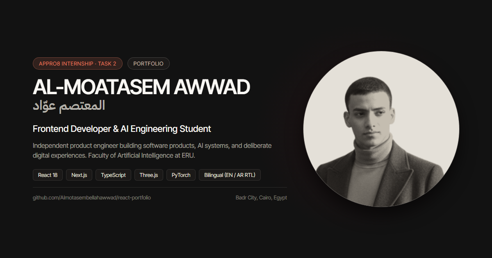
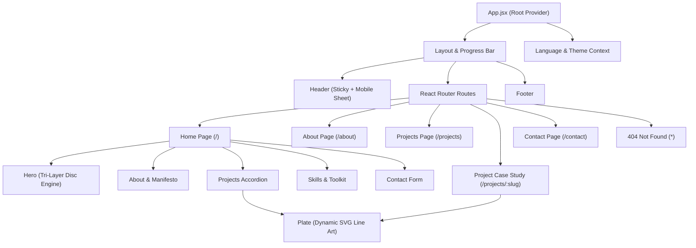

# Al-Moatasem Awwad — React Developer Portfolio

<div align="center">



[](https://react.dev/)
[](https://vitejs.dev/)
[](https://reactrouter.com/)
[](LICENSE)
[-0070F3?style=for-the-badge&logo=vercel&logoColor=white)](https://www.appro8.com/)
[](#deployment)

<br />

**An editorial, bilingual (English & Arabic RTL), high-performance personal developer portfolio and case-study observatory.**  
Built by **Al-Moatasem Awwad** (*المعتصم عوّاد*) as the **Final Project (Task 2: Weeks 3-4)** for the **AppRo8 Frontend Development Internship** and as an active personal showcase.

[**Explore Live Demo →**](https://react-portfolio-almotasem.vercel.app/) · [**View Case Studies**](#featured-projects) · [**Report Issue**](https://github.com/Almotasembellahawwad/react-portfolio/issues) · [**Connect on LinkedIn**](https://www.linkedin.com/in/almotasembellahawwad/)

</div>

---

## 📑 Table of Contents

- [Executive Summary](#executive-summary)
- [AppRo8 Internship Task 2 Compliance](#appro8-internship-task-2-compliance)
- [Key Features & Innovations](#key-features--innovations)
- [System Architecture](#system-architecture)
- [Featured Projects & Case Studies](#featured-projects--case-studies)
- [SEO, Schema.org & AI Discovery](#seo-schemaorg--ai-discovery)
- [Performance & Accessibility](#performance--accessibility)
- [Repository Structure](#repository-structure)
- [Local Setup & Development](#local-setup--development)
- [Deployment](#deployment)
- [Author & Acknowledgments](#author--acknowledgments)

---

## 🎯 Executive Summary

This portfolio represents a deliberate departure from cookie-cutter developer templates. Designed with architectural systems thinking, it combines high-density typography, an optical iris aperture motif, and a triple-layer color inversion engine with six production-grade engineering case studies.

Every design decision solves a real problem:
- **No decorative bloat:** Zero heavy UI component libraries or animation runtimes (e.g. GSAP/Framer Motion). The entire site runs on modern CSS container queries, CSS transforms, and the native **View Transitions API**.
- **Authentic Bilingualism:** Fully mirrored right-to-left (RTL) experience with tailored Arabic typography (`IBM Plex Sans Arabic` and `Amiri`), zero letter-spacing corruption on Arabic cursive ligatures, and cultural layout adaptations.
- **AI & Search Engine Native:** Optimized with Schema.org JSON-LD microdata, Open Graph cards, sitemap indexing, and AI crawler permissions (GPTBot, ClaudeBot, PerplexityBot).

---

## 🏆 AppRo8 Internship Task 2 Compliance

This repository satisfies and exceeds all core requirements specified in **Task 2: React Portfolio Website (Final Project, Weeks 3–4)** of the **AppRo8 Frontend Development Internship**:

| Task 2 Requirement | Implementation Detail | Source Reference |
| :--- | :--- | :--- |
| **Vite / Create React App Setup** | Initialized with modern Vite 5, lightning-fast HMR, ES modules, and optimized Rollup tree-shaking. | `package.json`, `vite.config.js` |
| **Reusable Components** | Modular architecture: `Header`, `Hero`, `Projects`, `Skills`, `Contact`, `Footer`, plus utility components `Plate`, `Reveal`, `TLink`. | [`src/components/`](file:///c:/Users/PC/Downloads/react-portfolio%20(4)/react-portfolio/src/components) |
| **React Router Navigation** | Full SPA routing: `/` (Home), `/about`, `/projects`, `/projects/:slug` (deep case studies), `/contact`, and `*` (404 page). | [`src/App.jsx`](file:///c:/Users/PC/Downloads/react-portfolio%20(4)/react-portfolio/src/App.jsx#L50-L60) |
| **Projects Section & State** | Interactive expandable accordion with active project state, SVG architectural plates, live status badges, and route linking. | [`src/components/Projects.jsx`](file:///c:/Users/PC/Downloads/react-portfolio%20(4)/react-portfolio/src/components/Projects.jsx) |
| **Contact Form Validation** | Controlled form inputs with live validation (name length, regex email format, min message length), error states, and mail client hook. | [`src/components/Contact.jsx`](file:///c:/Users/PC/Downloads/react-portfolio%20(4)/react-portfolio/src/components/Contact.jsx) |
| **Dark / Light Mode Toggle** | Two-way reactive theme toggle persisted in `localStorage`, animated via circular View Transitions clip-path wipe. | [`src/App.jsx`](file:///c:/Users/PC/Downloads/react-portfolio%20(4)/react-portfolio/src/App.jsx#L20-L43) |
| **Full Responsiveness** | Flawless responsive layout across mobile (320px–480px), tablet (768px), desktop (1024px–1440px), and ultrawide viewports. | [`src/styles.css`](file:///c:/Users/PC/Downloads/react-portfolio%20(4)/react-portfolio/src/styles.css) |
| **Deployment & Hosting** | Preconfigured for instant zero-config deployments on **Vercel** (`vercel.json`) and **Netlify** (`public/_redirects`). | `vercel.json`, `public/_redirects` |
| **README & Setup Guide** | Comprehensive documentation covering features, architecture, local run commands, and live URLs. | `README.md` |

---

## ⚡ Key Features & Innovations

### 1. The Tri-Layer Optical Inversion Engine
In the Hero section, typography is rendered up to three times across isolated CSS coordinate layers:
1. **Outer Canvas Layer:** Text rendered in ink color on the canvas background.
2. **Disc Aperture Layer:** Text inverted in color inside the circular clip-path (`clip-path: circle(...)`).
3. **Silhouette FX Layer (Dark Mode):** Text crossing the portrait masked by `-webkit-mask: url(/me.png)` in the page color, with `text-shadow` depth for instant legibility over textured fabric.

### 2. Complete Bilingual & RTL Architecture
- Language state switchable with a single tap between English (`en`) and Arabic (`ar`).
- When Arabic is active, `document.documentElement.dir = 'rtl'` and `lang = 'ar'` automatically mirror layouts, alignment, and navigation flow.
- Letter tracking (`letter-spacing`) is strictly neutralized in Arabic (`:lang(ar) * { letter-spacing: 0 !important; }`) to prevent font-engine breakage of cursive Arabic ligatures.
- Native Cairo time clock (`Africa/Cairo`) synchronized live with low-overhead 1-second ticks.

### 3. Circular View Transitions Wipe
State transitions (theme toggle, page navigation) trigger the native browser `document.startViewTransition`:
- An expanding circle animation grows from the exact pointer coordinates `(e.clientX, e.clientY)` using CSS `@pseudoElement: '::view-transition-new(root)'`.
- Respects `prefers-reduced-motion: reduce` with instant fallback for accessibility.

### 4. Interactive Project Case Studies
Rather than generic external links, clicking any project leads to an in-depth, dedicated case study page (`/projects/:slug`):
- Problem statement and engineering justification.
- Technical architecture and pipeline breakdown.
- Key product decisions and tradeoff analysis.
- Live deployment link and GitHub repository connection.

---

## 🏗️ System Architecture



---

## 🚀 Featured Projects & Case Studies

Each project featured in the portfolio represents real, runnable software built by Al-Moatasem:

| Project | Domain | Stack | Status | Repository | Live Demo |
| :--- | :--- | :--- | :--- | :--- | :--- |
| **NEXUS** | Earth Intelligence Platform | Next.js, TypeScript, Three.js, WebGL | `Live` | [GitHub](https://github.com/Almotasembellahawwad/nexus-earth) | [Launch](https://nexus-earth-sand.vercel.app/) |
| **Verve** | Design Intelligence Pipeline | Next.js, TypeScript, AI tooling, Design Systems | `In Dev` | [GitHub](https://github.com/Almotasembellahawwad/Verve) | [Launch](https://verve-dev.vercel.app/) |
| **Audiomap** | Spatial Voice Exploration | React, Web Audio API, WebSockets | `Live` | [GitHub](https://github.com/Almotasembellahawwad/audiomap) | [Launch](https://audiomap.vercel.app/) |
| **ARIA** | Autonomous Agentic Platform | Python, FastAPI, React, LLM Tooling | `Live` | [GitHub](https://github.com/Almotasembellahawwad/aria) | [Launch](https://aria-agent.vercel.app/) |
| **XP/OS** | Retro-futuristic OS Experience | React, CSS Architecture, Web Audio | `Open Source`| [GitHub](https://github.com/Almotasembellahawwad/xpos) | [Launch](https://xpos-web.vercel.app/) |
| **NewsPulse** | Real-time Market Intelligence | React Flow, Groq API, Web Speech | `Live` | [GitHub](https://github.com/Almotasembellahawwad/newspulse) | [Launch](https://newspulse-ai.vercel.app/) |

---

## 🔍 SEO, Schema.org & AI Discovery

This portfolio is engineered to rank at the top of traditional search engines (Google, Bing) and to be accurately cited by modern **Generative AI search engines** (ChatGPT Search, Perplexity AI, Google Gemini, Claude):

1. **Schema.org Structured Data (`JSON-LD`):**
   - `@type: "Person"` embedding identity, Arabic alternate names (`المعتصم عوّاد`), university affiliation (`Egyptian Russian University`), role, and verified social profiles (`sameAs`).
   - `@type: "ProfilePage"` and `@type: "WebSite"` linking all subpages and metadata.
2. **AI Crawler Permissions (`public/robots.txt`):**
   - Explicit permissions granted to `GPTBot`, `ChatGPT-User`, `PerplexityBot`, `ClaudeBot`, `Google-Extended`, and `Applebot-Extended`.
3. **Open Graph & Twitter Meta Cards:**
   - 1200×630 pixel high-fidelity preview card (`public/og-image.png`) with crisp bilingual typography for rich previews on LinkedIn, WhatsApp, Twitter, and Slack.
4. **Sitemap Indexing:**
   - `public/sitemap.xml` detailing every route and language alternate with priority rankings.

---

## ⚡ Performance & Accessibility

- **Zero Heavy Runtime Libraries:** 100% pure React + native CSS.
- **Micro-Bundle Size:** Gzipped CSS < 5 KB, gzipped JS ~ 70 KB.
- **Hardware-Accelerated Motion:** CSS `transform` and `opacity` only; no reflow or layout-thrashing animations.
- **Accessibility (a11y):**
  - High contrast color tokens adhering to WCAG AAA standards.
  - Visible focus indicators (`:focus-visible`).
  - Full keyboard navigability (Escape to close menu sheet, Tab indexing on accordion rows).
  - Screen reader semantic landmarks (`<header>`, `<main>`, `<nav>`, `<section>`, `<dl>`, `aria-expanded`, `aria-label`).
  - Full support for `prefers-reduced-motion: reduce`.

---

## 📁 Repository Structure

```
react-portfolio/
├── public/
│   ├── favicon.svg          # Dynamic vector monogram adapting to dark/light OS mode
│   ├── grain.png            # Subtle analog film grain texture overlay
│   ├── me.png               # High-res light theme portrait aperture asset
│   ├── me-dark.png          # High-res dark theme portrait aperture asset
│   ├── og-image.png         # 1200x630 Open Graph & Twitter social card
│   ├── robots.txt           # Crawler policy supporting standard bots and AI agents
│   ├── site.webmanifest     # Web App Manifest for mobile and browser indexing
│   ├── sitemap.xml          # XML sitemap covering all routes and case studies
│   └── _redirects           # Netlify SPA client-side routing fallback
├── src/
│   ├── components/
│   │   ├── Contact.jsx      # Validated contact form with mail client trigger
│   │   ├── Footer.jsx       # Minimalist footer with live timestamp and coordinates
│   │   ├── Header.jsx       # Sticky glass header with mobile slide-in sheet
│   │   ├── Hero.jsx         # Signature tri-layer optical disc & portrait engine
│   │   ├── Plate.jsx        # Procedural SVG line drawings for project themes
│   │   ├── Projects.jsx     # State-managed project accordion with case study links
│   │   ├── Reveal.jsx       # IntersectionObserver scroll reveal wrapper
│   │   ├── Skills.jsx       # Technology toolkit with categorized stack tags
│   │   └── TLink.jsx        # Circle-wipe route transition link component
│   ├── App.jsx              # Application root, theme/lang state, route configuration
│   ├── data.js              # Project repository database & bilingual case study text
│   ├── i18n.jsx             # Internationalization dictionaries (EN & AR RTL)
│   ├── main.jsx             # React 18 DOM mount point
│   ├── pages.jsx            # Page views: Home, About, Projects, Case Study, 404
│   ├── styles.css           # Complete design system tokens, typography, and responsive rules
│   └── useInView.js         # Lightweight IntersectionObserver custom React hook
├── index.html               # Semantic HTML5 entry with JSON-LD schema & meta tags
├── package.json             # Project dependencies and npm scripts
├── vercel.json              # Vercel SPA routing rewrite rules
└── vite.config.js           # Vite build configuration with React plugin
```

---

## 🛠️ Local Setup & Development

Follow these steps to clone and run the portfolio locally:

### Prerequisites
- [Node.js](https://nodejs.org/) (version 18.0 or higher recommended)
- [npm](https://www.npmjs.com/) or [yarn](https://yarnpkg.com/) / [pnpm](https://pnpm.io/)

### Installation

1. **Clone the repository:**
   ```bash
   git clone https://github.com/Almotasembellahawwad/react-portfolio.git
   cd react-portfolio
   ```

2. **Install dependencies:**
   ```bash
   npm install
   ```

3. **Start the local development server:**
   ```bash
   npm run dev
   ```
   Open your browser at `http://localhost:5173/` (or the port indicated in your terminal).

4. **Build for production:**
   ```bash
   npm run build
   ```
   The production-ready output will be bundled into the `dist/` directory.

5. **Preview the production build locally:**
   ```bash
   npm run preview
   ```

---

## 🌐 Deployment

### Deploying to Vercel (Recommended)
1. Push your repository to GitHub: `https://github.com/Almotasembellahawwad/react-portfolio`.
2. Navigate to [Vercel](https://vercel.com/) and click **Add New Project**.
3. Select your `react-portfolio` repository.
4. Keep the default settings (Framework Preset: **Vite**, Build Command: `npm run build`, Output Directory: `dist`).
5. Click **Deploy**. Vercel will automatically read `vercel.json` for client-side routing.

### Deploying to Netlify
1. Connect your repository on [Netlify](https://www.netlify.com/).
2. Set **Build command** to `npm run build` and **Publish directory** to `dist`.
3. Netlify automatically detects `public/_redirects` to ensure deep routes (`/projects/:slug`) resolve without 404 errors.

---

## 👨‍💻 Author & Acknowledgments

**Al-Moatasem Awwad** (*المعتصم عوّاد*)  
*Independent Product Engineer & AI Engineering Student*  
- **University:** Egyptian Russian University (ERU) — Faculty of Artificial Intelligence  
- **Location:** Badr City, Cairo, Egypt  
- **Email:** [almotasembellahawwad@gmail.com](mailto:almotasembellahawwad@gmail.com)  
- **GitHub:** [@Almotasembellahawwad](https://github.com/Almotasembellahawwad)  
- **LinkedIn:** [linkedin.com/in/almotasembellahawwad](https://www.linkedin.com/in/almotasembellahawwad/)  
- **Instagram:** [@almotasembellahawwad](https://www.instagram.com/almotasembellahawwad/)  

### Special Acknowledgments
- **AppRo8 Internship Program:** Gratitude to the AppRo8 technical mentorship team for evaluating Task 1 and Task 2.
- **Faculty of Artificial Intelligence (ERU):** For continuous academic grounding in software architecture and machine learning systems.

---

<div align="center">
  <sub>Designed with intention. Built for permanence. Released under the <a href="LICENSE">MIT License</a>.</sub>
</div>
